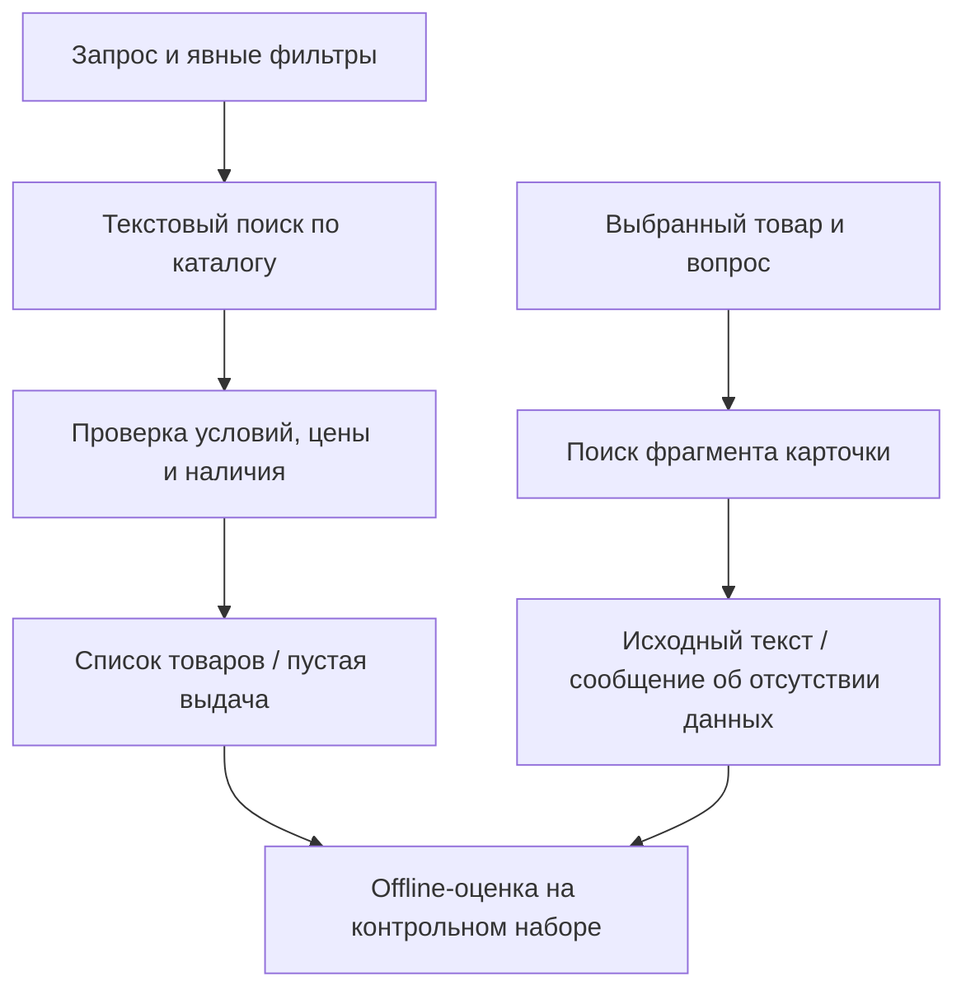
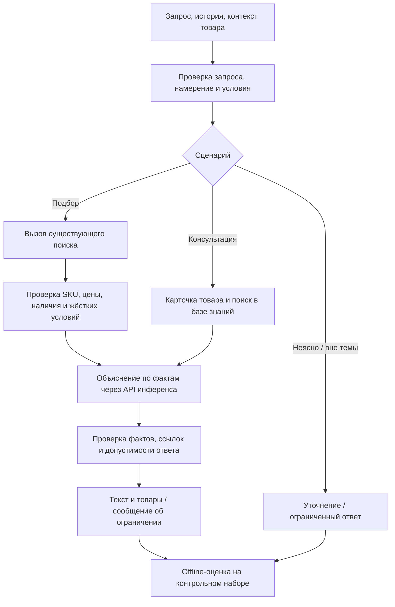

# ML System Design: диалоговый бьюти-ассистент

Автор: Юлия Горшкова · Итерация: HW2 · Статус: проект дизайна · 13.11.2026

## 1. Цели и предпосылки

### 1.1. Зачем идём в разработку продукта

Покупателю сложно перевести потребность в фильтры каталога и понять, подходит ли
конкретное средство. Ассистент помогает сузить выбор и объясняет рекомендации.
Стратегическая цель (Horizon 3) — повышение лояльности через рост MRR
(Monthly Retention Rate, месячное удержание). Быстрая окупаемость не является
критерием первой итерации. Цель пилота — увеличить конверсию в добавление
в корзину на 1 процентный пункт относительно контроля: например, с 20% до 21%.
Первый этап пилота также оценивает вовлечённость, качество ответов и нагрузку.
Прирост конверсии должен достигаться без роста возвратов.

ML нужен для понимания свободного запроса и продолжений диалога. Собственная
оркестрация позволит управлять источниками и качеством объяснений. Пользу
относительно обычного поиска предстоит проверить.

Текущий поиск требует сформулированных фильтров; консультация оператора требует
ожидания и ручной работы. Ассистент проверяет гипотезу, что диалог уменьшит этот
барьер. Масштаб проблемы и достижимость +1 п.п. пока не измерены: на первом этапе
фиксируем воронку и причины неуспешного выбора. Статистический расчёт выборки
не является обоснованием достижимости продуктового эффекта.

### 1.2. Бизнес-требования и ограничения

- Подбирать реальные товары с учётом явно заданных бюджета, свойств и контекста.
- Отвечать по характеристикам и применению товара на основе проверяемых источников.
- Сохранять условия текущего диалога; уточнять недостающие данные без повторных вопросов.
- Проверять цену и наличие перед выдачей; не придумывать товары и свойства.
- При нехватке данных сообщать об ограничении; при сбое предлагать повтор или поиск.
- Не ставить диагнозы и не назначать лечение. Пограничные случаи требуют экспертных правил.

Показатели MVP:

| Показатель                                 | Как измерять                                                                                                                                                    |
| ------------------------------------------ | --------------------------------------------------------------------------------------------------------------------------------------------------------------- |
| Основной: конверсия в добавление в корзину | Доля пользователей с добавлением в корзину за 7 дней после включения в группу; цель — прирост на 1 п.п.                                                         |
| Лояльность: MRR                            | Пользователи стартовой когорты, вернувшиеся в приложение в следующем календарном месяце / все пользователи стартовой когорты; цель — рост относительно контроля |
| Вовлечённость                              | Пользователи группы B, начавшие диалог за те же 7 дней / все пользователи группы B                                                                              |
| Качество ответа                            | Доля запросов с выполнением всех параметров матрицы; на контрольной выборке ≥90%                                                                                |
| Защитные показатели                        | 0 критических нарушений на контрольной выборке; жалобы и возвраты                                                                                               |
| Производительность и ресурсы               | p95 полного ответа ≤12 с; технические ошибки ≤1% запросов; загрузка GPU и стоимость диалога                                                                     |

Воронка пилота: показ точки входа → начало диалога → добавление в корзину.
Время полного ответа считается от отправки запроса пользователем; доля технических
ошибок — число запросов со сбоем или таймаутом / число всех запросов. Вычислительный бюджет —
8 × NVIDIA H100 on-prem. На пилоте оцениваем затраты проекта на диалог и успешно
решённый запрос для планирования масштабирования.
Первый этап A/B-пилота — 10 000 пользователей суммарно, по 5 000 в группе.
Он проверяет вовлечённость, качество и фактическую нагрузку. Для проверки
целевого бизнес-эффекта планируется расширение выборки до 80 000 пользователей
суммарно, по 40 000 в группе, после достижения указанных порогов качества и надёжности,
при готовой аналитике и подтверждённой ёмкости в пределах выделенного ресурса.
Решение о расширении принимают Product и CPO. Критические нарушения — выдуманные
товары/составы, нарушение обязательных ограничений и опасные рекомендации — блокируют запуск.

### 1.3. Что входит в scope

HW2: EDA оценочного набора и проектирование подготовки данных, моделей и проверки.
Категории MVP: макияж, уход, парфюмерия. Состав MVP:

| Входит                                            | За пределами первой итерации                                               |
| ------------------------------------------------- | -------------------------------------------------------------------------- |
| Подбор по запросу и изменение условий в диалоге   | Аналоги, сравнение нескольких товаров, сложные рутины                      |
| Консультация по одному товару                     | Персонализация по покупкам и долговременная память                         |
| Обработка неоднозначного и нерелевантного запроса | Полноценная поддержка, оформление заказа                                   |
| Offline-оценка и поэтапный A/B-пилот              | Масштабирование на всю аудиторию, разработка фронтенда и чатовой платформы |

Если подходит один товар, консультируем по нему; если несколько — показываем top-k
(ориентировочно 3–6, без добора неподходящих товаров). Пилот использует готовый фронт чатов.
Расширенная модель условий, пожеланий и противоречий предварительно отнесена
к развитию после MVP; проверки бюджета и наличия обязательны уже в MVP.
Интерфейс, хранение истории и действия с корзиной относятся к внешнему приложению.
AI-сервис получает историю на входе и остаётся stateless. Масштабирование
на всю аудиторию и автоматическое обновление индексов отложены.

### 1.4. Предпосылки решения

| Данные                                     | Для чего нужны                                     | Доступность |
| ------------------------------------------ | -------------------------------------------------- | ----------- |
| Каталог: SKU, описания, составы и атрибуты | Поиск и факты о товаре                             | Есть        |
| Цены и наличие по географии                | Проверка возможности покупки                       | Есть        |
| Отзывы                                     | Дополнительная информация о пользовательском опыте | Есть        |
| База знаний                                | Retrieval для консультаций                         | Есть        |
| 213 реплик в 178 оценочных диалогах        | Диагностика baseline и MVP                         | Есть        |

Финальный набор содержит 192 основные реплики в 164 диалогах и 21 негативную
проверку в 14 диалогах. 250 обращений были промежуточным отбором. В финальной версии
есть категории, признаки запроса и применимые критерии; часть разметки предварительная.
Это не готовые эталоны интентов и релевантности новых ответов. Состав и ограничения
проверены в [EDA](../reports/eda/report.md).

Запросы русскоязычные. Модели размещены on-prem; агент вызывает собственный сервис
инференса через API. Обучение собственной LLM в первую итерацию не входит.
Перед экспериментами проверяются актуальность, полнота товарных данных и качество
материалов базы знаний.

## 2. Методология

### 2.1. Постановка задачи

Вход: сообщения диалога, контекст страницы, выбранный товар и география,
если доступны. Выход: ответ, идентификаторы товаров и уточнение при необходимости.
Решаем задачи классификации намерения, извлечения условий, поиска кандидатов
и генерации ответа с опорой на источники (RAG).

**Baseline:** обычный поиск по тексту и явно заданным фильтрам; консультация
возвращает релевантный фрагмент карточки. Генерации и понимания истории нет.
**MVP:** LLM извлекает условия из диалога, выбирает сценарий и объясняет
результаты поиска или retrieval. Конкретные модели выбираются экспериментом.
Поиск переиспользуется как существующий сервис; разработка его алгоритмов
и ранжирования находится за границами проекта.

### 2.2. Блок-схемы решения

#### 2.2.1. Baseline

#### 2.2.2. MVP

При пустой выдаче условия не ослабляются молча. Неподтверждённая цена или
наличие исключают рекомендацию к покупке. Ошибки поиска и генерации ведут
к сообщению об ограничении; число вызовов и повторы ограничены.

### 2.3. Этапы решения задачи

#### Этап 1. Подготовка данных

| Сущность          | Состав и получение                                                                  | Подготовка и результат                                                                                    |
| ----------------- | ----------------------------------------------------------------------------------- | --------------------------------------------------------------------------------------------------------- |
| Оценочные диалоги | Пакетные выгрузки XLSX/JSON, экспертные сценарии и отдельные синтетические проверки | Версия JSON с `dialog_id`, порядком ходов, ролью, метками и критериями; сырые тексты сохраняются отдельно |
| Товарные факты    | SKU, категории, составы, описания; цена и наличие из существующих сервисов          | Снимок фактов для воспроизведения offline-прогона; живые цена и наличие проверяются при выдаче            |
| База знаний       | Подготовленные материалы о свойствах и применении                                   | Документы с версиями и идентификаторами фрагментов для проверки обоснованности                            |

Пайплайн обращений: экспорт 2382 строк → выделение 1404 товарных вопросов →
LLM-предразметка → отбор по покрытию и сложности → 120 обращений → объединение
с 91 уникальной экспертной репликой и 2 синтетическими проверками. Сборка пакетная;
новая версия фиксируется перед изменением оценочного набора, без перезаписи старой.
Версии каталога и знаний привязываются к прогону. Качество их полного содержимого
в текущем EDA не измерялось: до прогона проверяются схема, SKU, обязательные поля,
свежесть цены/наличия и связь фрагментов с документами.

EDA выявил: 13 повторений текста отдельных реплик при отсутствии дублей полных
диалогов; 6 пометок об отсутствии ответа среди 120 заполненных ответов операторов;
преобладание ухода за лицом; только 5 основных реплик с недостатком информации.
Сравнения и сложные рутины в исходной основной части не входят в MVP. Поэтому
назначаем кейсам `mvp_scope` по возможностям системы; неподдерживаемые задачи
проверяем на корректное ограничение, отдельно от качества подбора.

Нормализуем текст только для поиска дублей; модель получает очищенную исходную
формулировку. Удаляем контакты и идентификаторы заказов/пользователей, проверяем
URL и свободный текст. Идентификаторы заменяются локальными псевдонимами,
таблица соответствий хранится отдельно. Regex-проверка дополняется ручной:
в ответах операторов обнаружены 4 кандидата на телефонные номера. Ответы
операторов и исторические оценки не считаются подтверждёнными эталонами новой модели.

Текущие данные используем для диагностики, а не независимого доказательства качества.
Для приёмки собираем **ещё 150 новых диалогов**: по 25 на сочетание трёх категорий
MVP и двух основных сценариев. Внутри квот включаем уточнения, изменения условий
и многоходовость. При качестве около 90% 150 независимых наблюдений дают ориентир
точности около ±5 п.п. при 95%; для многоходовых метрик интервал считаем по диалогам.
Дополнительно нужны **40 новых проверок границ**: восемь групп по пять вариантов
(недоступный профиль, заказ/корзина, персональные условия, сравнения, сложные рутины,
неподтверждённые факты, медицинские назначения, выход из роли). Это покрытие рисков,
а не оценка частоты редких ошибок. Источники — новые обращения и экспертные сценарии;
синтетические варианты проходят экспертную проверку и не подменяют реальный поток.

**Выход этапа:** версионированные данные и рубрики, проверенные метки, связи с фактами,
группы близких сценариев и закрытый контроль без пересечений с диагностическим пулом.
Для baseline и MVP используются одинаковые входы и источники; обучения LLM на этих
диалогах в первой итерации нет. Ответственный — DS совместно с экспертами и методологами.

#### Этап 2. Подготовка моделей и ML-валидация

| Компонент          | Baseline                                                    | MVP и развитие                                                               |
| ------------------ | ----------------------------------------------------------- | ---------------------------------------------------------------------------- |
| Подготовка запроса | Текст и явные фильтры; неоднозначность приводит к уточнению | LLM извлекает условия из переданной истории; структура проверяется по схеме  |
| Подбор             | Существующий текстовый поиск и обязательные фильтры         | Тот же сервис поиска; LLM объясняет и выбирает до 3–6 подходящих товаров     |
| Консультация       | Фрагмент карточки без генерации                             | Ответ по карточке и retrieved-фрагментам базы знаний с проверяемыми ссылками |
| Неподдерживаемое   | Ограниченный шаблонный ответ                                | Маршрутизация в уточнение/ограничение без выдуманных возможностей            |

Модели вызываются через собственный on-prem API; веса заморожены. Перед прогоном
фиксируются точный ID и версия модели, параметры инференса, промпты и версии данных.
Отдельной функции обучения у baseline и MVP нет. Ошибка задачи для подбора
конфигурации — `L = 1 − SR_turn`; она не является token-level loss обучения LLM.
Сначала выполняются ограничения достоверности, качества и SLA, затем выбирается
конфигурация с меньшей ошибкой и меньшими затратами. Fine-tuning не планируется:
текущий набор мал и не содержит полных проверенных ответов для всех сценариев.

| Метрика                | Определение и применение                                                                                                                                                           |
| ---------------------- | ---------------------------------------------------------------------------------------------------------------------------------------------------------------------------------- |
| `SR_turn`              | Доля запросов, где выполнены все применимые параметры; критерий приёмки ≥90%. Если критерий нельзя проверить без источника, запрос не засчитывается успешным до устранения пробела |
| `SR_dialog`            | Доля диалогов, где выполнены критерии всех ходов и всей последовательности; диагностика потери контекста                                                                           |
| Релевантность подборок | Доля непустых подборок, где каждый товар релевантен; пустые выдачи публикуются отдельно. Метки ставятся на ответы нового прогона                                                   |
| Macro-F1 маршрутизации | По экспертным меткам «подбор / консультация / уточнение / ограничение»; категории вопросов не подставляются как готовый интент. Диагностика причин ошибок                          |
| Проверки границ        | Доля корректных ограничений на отдельном наборе и число критических нарушений; при приёмке критических нарушений — 0                                                               |
| Обоснованность         | Подтверждение утверждений зафиксированными товарными фактами/фрагментами; ошибки разбираются по критериям достоверности                                                            |
| Производительность     | p95 полного ответа ≤12 с, технические ошибки ≤1%; измеряются по журналу прогона, а не LLM-судьёй                                                                                   |

Эти метрики проверяют механизм ожидаемой пользы: верный маршрут и релевантная,
обоснованная выдача помогают продолжить выбор; причинный эффект на корзину и
удержание проверяет только пилот. Владелец offline-метрик — DS и методологи,
SLA — команда сервиса; бизнес-метрик — Product с аналитиком.
Порог ≥90% относится к наблюдаемой доле успеха на контроле; доверительный интервал
публикуется отдельно и не означает, что его нижняя граница тоже достигла 90%.

Текущий набор — диагностический: его уже просматривали при подготовке решения.
Новые данные делим по времени сбора; целые диалоги и семейства перефразов не
попадают одновременно в настройку и закрытый контроль. Близость проверяем
нормализованным текстом и экспертной группировкой; один seed не устраняет утечку.
Закрытый контроль не используется для выбора промпта и параметров. Baseline и MVP
прогоняются на одинаковых кейсах; история включает только предшествующие ходы
и собственные ответы оцениваемой версии, без будущих реплик и ответов оператора.
Метрики публикуются по сценариям, категориям и сложности; интервалы и парное
сравнение считаются с группировкой по диалогу, а не по отдельным репликам.

На диагностическом пуле поочерёдно сравниваем доступные on-prem модели, температуру
0/0,2, 3/6 товаров в выдаче и 3/5 фрагментов знаний. Меняем один фактор за раз,
фиксируем качество, задержку, объём контекста и GPU-время; итоговую конфигурацию
выбираем до закрытого прогона. Разработка ранжирования существующего поиска вне scope.
Факты каталога передаются структурированно; масштабирование числовых признаков
или искусственный feature engineering для генерации не требуется.

**Выход этапа:** воспроизводимые конфигурации baseline/MVP и протокол парной оценки.
Риски — ошибки предварительных меток, мало редких случаев, переобучение промпта
на известном наборе и смещение LLM-судьи. Их снижают экспертная проверка,
дополнение покрытия и закрытый контроль. Новых измерений качества моделей пока нет.

#### Этап 3. Проверяемые ответы и границы возможностей

Для baseline сохраняем найденные SKU/фрагменты; для MVP — также извлечённые условия,
использованные факты и ссылки. Цена и наличие подтверждаются перед рекомендацией.
Вопросы о личных скидках, профиле и недоступной корзине не приравниваются к обычной
проверке цены: решение зависит от реально доступных источников. Ошибка или пустой
результат не дают права ослаблять обязательные условия.

Эксперты оценивают применимые критерии `pass/fail`; диалоговые критерии проверяются
по всей последовательности. `not_applicable` требует обоснования и допустим только
для реально не возникшей ветки; `not_observable` означает нехватку проверочного
источника. Если достаточный запрос остался без выдачи, это ошибка, а не исключение
из знаменателя. LLM-судья помогает сравнивать версии; окончательная приёмка ручная.
Его промпт настраивается и проверяется на разных экспертных подвыборках, включая
ошибочные ответы; отдельно анализируются пропущенные нарушения.

Интерпретация строится по трассам: ошибка маршрута → потерянное условие → пустой
поиск → нерелевантный SKU → неподтверждённый факт → потеря контекста → задержка.
Показываем примеры улучшений и ухудшений относительно baseline с доказательствами.

**Выход этапа:** экспертный протокол, перечень критических нарушений и регрессионные
кейсы. Риск неверного совета по составу снижается проверкой источника и экспертными
правилами; диагнозы и назначения лечения исключены. Владелец — методологи и DS.

#### Этап 4. Инференс и готовность к пилоту

Обе версии подключаются к готовому чату; сервис получает историю на входе.
Ограничиваем контекст, число обращений к источникам и повторы; при исчерпании
бюджета времени возвращается ограниченный ответ. На стенде измеряем задержку
при росте конкурентных запросов, ошибки, потребление памяти и GPU-время в пределах
8 × H100. Аудитория 10 000 человек сама по себе не задаёт QPS: сценарии нагрузки
уточняются по вовлечённости и запросам на активного пользователя.

Стоимость диалога = затраты выделенного ресурса за период / завершённые диалоги;
стоимость успешного запроса = все затраты периода / число успешных запросов,
включая затраты неудачных попыток в числителе. В затраты включаются
амортизация/аренда GPU, энергия, инфраструктура и эксплуатация. Пока тарифов нет,
фиксируем GPU-секунды и трудозатраты; Product и инфраструктурная команда согласуют
денежную оценку до расширения пилота. Быстрая окупаемость не заменяет стратегическую
цель удержания, но выделенное железо не считается бесплатным.

**Выход этапа:** совместимый API, нагрузочный отчёт, оценка затрат и решение
Product/CPO о первом запуске. Критические нарушения блокируют запуск; недобор
качества/SLA ведёт к доработке. Недостаток наблюдений продлевает сбор без вывода
об эффекте. Расширение возможно после выполнения порогов, готовности аналитики
и подтверждения ёмкости; поддержка команды сервиса обязательна.

### 2.4. План проверки пилота

В A/B-пилоте группа A использует приложение без ассистента, B — с ассистентом.
Случайное распределение по пользователям 50/50 выполняется до показа точки входа.
Конверсия и MRR считаются по всем пользователям каждой группы, вовлечённость — по B.
MRR оценивается после завершения следующего календарного месяца; возвраты —
после завершения применимого окна возврата заказов обеих групп. На первом этапе
проверяются также фактическая нагрузка и SLA в пределах 8 × H100.

Расчёт выборки для конверсии в корзину: нормальное приближение для двустороннего теста двух долей,
уровень значимости 5%, мощность 80%, единица наблюдения — уникальный пользователь. В расчётном примере при конверсии 20%
для обнаружения прироста на 1 п.п. нужно около 52 000 пользователей суммарно;
10 000 позволяют обнаружить прирост примерно от 2,29 п.п. с той же мощностью.
План 80 000 выбран консервативно для максимальной дисперсии конверсии: максимальная
расчётная потребность для эффекта 1 п.п. — около 78 500 пользователей.
Выборка накапливается по уникальным пользователям; повторные запросы не увеличивают
её размер. Оценка предполагает полное наблюдение метрики в одинаковом окне.
Решение по конверсии принимается на запланированном размере выборки.
При изменении реализации после первого этапа основная проверка проводится заново.
