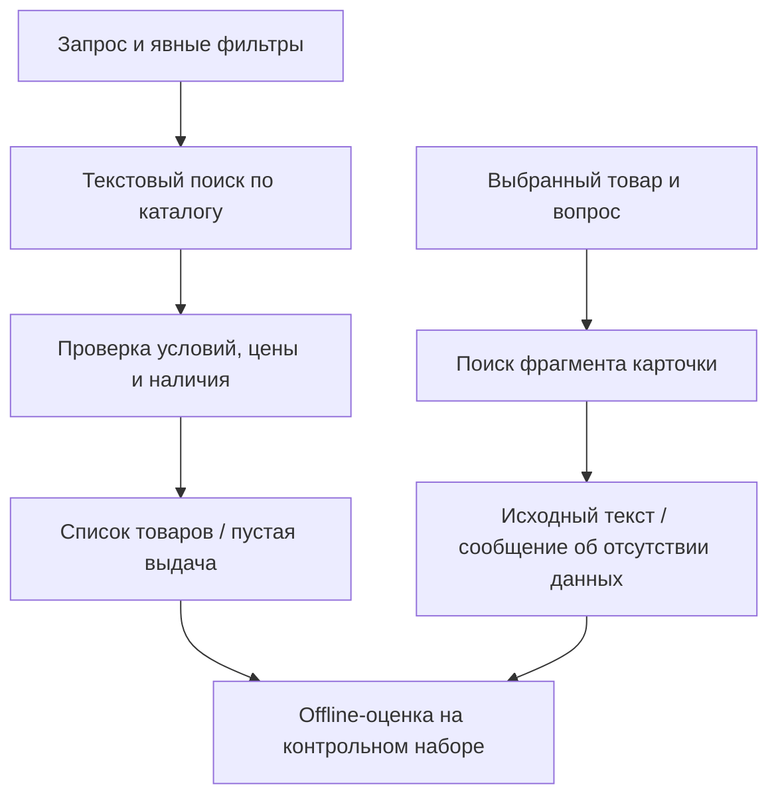
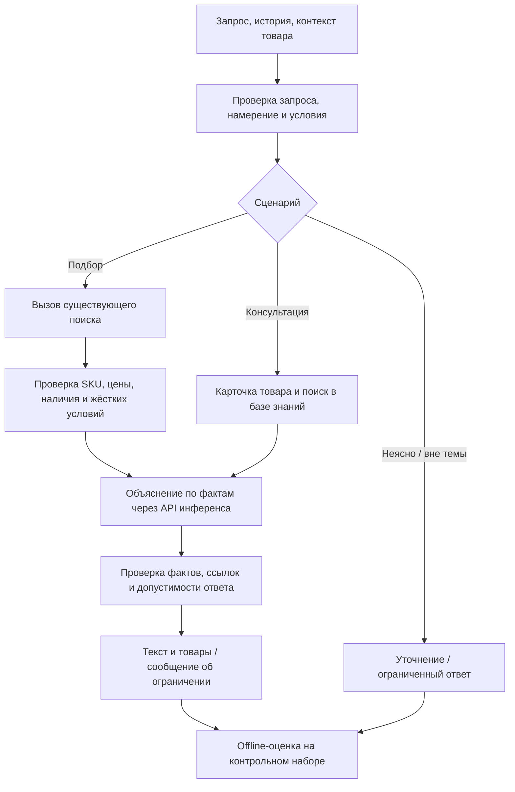

# ML System Design: диалоговый бьюти-ассистент

Автор: Юлия Горшкова · Итерация: HW1 · Статус: проект дизайна · 29.10.2026

## 1. Цели и предпосылки

### 1.1. Зачем идём в разработку продукта

Покупателю сложно перевести потребность в фильтры каталога и понять, подходит ли
конкретное средство. Ассистент помогает сузить выбор и объясняет рекомендации.
Стратегическая цель (Horizon 3) — повышение лояльности через рост MRR
(Monthly Retention Rate, месячное удержание). Быстрая окупаемость не является
критерием первой итерации. Цель пилота — увеличить конверсию в добавление
в корзину на 1 процентный пункт относительно контроля: например, с 20% до 21%.
Первый этап пилота также оценивает вовлечённость, качество ответов и нагрузку.
Прирост конверсии должен достигаться без роста возвратов.

ML нужен для понимания свободного запроса и продолжений диалога. Собственная
оркестрация позволит управлять источниками и качеством объяснений. Пользу
относительно обычного поиска предстоит проверить.

### 1.2. Бизнес-требования и ограничения

- Подбирать реальные товары с учётом явно заданных бюджета, свойств и контекста.
- Отвечать по характеристикам и применению товара на основе проверяемых источников.
- Сохранять условия текущего диалога; уточнять недостающие данные без повторных вопросов.
- Проверять цену и наличие перед выдачей; не придумывать товары и свойства.
- При нехватке данных сообщать об ограничении; при сбое предлагать повтор или поиск.
- Не ставить диагнозы и не назначать лечение. Пограничные случаи требуют экспертных правил.

Показатели MVP:

| Показатель                                 | Как измерять                                                                                                                                                    |
| ------------------------------------------ | --------------------------------------------------------------------------------------------------------------------------------------------------------------- |
| Основной: конверсия в добавление в корзину | Доля пользователей с добавлением в корзину за 7 дней после включения в группу; цель — прирост на 1 п.п.                                                         |
| Лояльность: MRR                            | Пользователи стартовой когорты, вернувшиеся в приложение в следующем календарном месяце / все пользователи стартовой когорты; цель — рост относительно контроля |
| Вовлечённость                              | Пользователи группы B, начавшие диалог за те же 7 дней / все пользователи группы B                                                                              |
| Качество ответа                            | Доля запросов с выполнением всех параметров матрицы; на контрольной выборке ≥90%                                                                                |
| Защитные показатели                        | 0 критических нарушений на контрольной выборке; жалобы и возвраты                                                                                               |
| Производительность и ресурсы               | p95 полного ответа ≤12 с; технические ошибки ≤1% запросов; загрузка GPU и стоимость диалога                                                                     |

Воронка пилота: показ точки входа → начало диалога → добавление в корзину.
Время полного ответа считается от отправки запроса пользователем; доля технических
ошибок — число запросов со сбоем или таймаутом / число всех запросов. Вычислительный бюджет —
8 × NVIDIA H100 on-prem. На пилоте оцениваем затраты проекта на диалог и успешно
решённый запрос для планирования масштабирования.
Первый этап A/B-пилота — 10 000 пользователей суммарно, по 5 000 в группе.
Он проверяет вовлечённость, качество и фактическую нагрузку. Для проверки
целевого бизнес-эффекта планируется расширение выборки до 80 000 пользователей
суммарно, по 40 000 в группе, после достижения указанных порогов качества и надёжности,
при готовой аналитике и подтверждённой ёмкости в пределах выделенного ресурса.
Решение о расширении принимают Product и CPO. Критические нарушения — выдуманные
товары/составы, нарушение обязательных ограничений и опасные рекомендации — блокируют запуск.

### 1.3. Что входит в scope

HW1: документ и воспроизводимые настройки репозитория.
Категории MVP: макияж, уход, парфюмерия. Состав MVP:

| Входит                                            | За пределами первой итерации                                               |
| ------------------------------------------------- | -------------------------------------------------------------------------- |
| Подбор по запросу и изменение условий в диалоге   | Аналоги, сравнение нескольких товаров, сложные рутины                      |
| Консультация по одному товару                     | Персонализация по покупкам и долговременная память                         |
| Обработка неоднозначного и нерелевантного запроса | Полноценная поддержка, оформление заказа                                   |
| Offline-оценка и поэтапный A/B-пилот              | Масштабирование на всю аудиторию, разработка фронтенда и чатовой платформы |

Если подходит один товар, консультируем по нему; если несколько — показываем top-k
(ориентировочно 3–6, без добора неподходящих товаров). Пилот использует готовый фронт чатов.
Расширенная модель условий, пожеланий и противоречий предварительно отнесена
к развитию после MVP; проверки бюджета и наличия обязательны уже в MVP.
Интерфейс, хранение истории и действия с корзиной относятся к внешнему приложению.
AI-сервис получает историю на входе и остаётся stateless. Масштабирование
на всю аудиторию и автоматическое обновление индексов отложены.

### 1.4. Предпосылки решения

| Данные                                     | Для чего нужны                                     | Доступность |
| ------------------------------------------ | -------------------------------------------------- | ----------- |
| Каталог: SKU, описания, составы и атрибуты | Поиск и факты о товаре                             | Есть        |
| Цены и наличие по географии                | Проверка возможности покупки                       | Есть        |
| Отзывы                                     | Дополнительная информация о пользовательском опыте | Есть        |
| База знаний                                | Retrieval для консультаций                         | Есть        |
| 250 тестовых диалогов                      | Offline-оценка baseline и MVP                      | Есть        |

250 реальных диалогов размечены экспертами и составляют всю текущую выборку.
Размечены интенты и общий флаг «все ли товары релевантны» для подборки.
Набор планируется пополнять на внутреннем пилоте и расширить к выходу на внешних
пользователей.

Запросы русскоязычные. Модели размещены on-prem; агент вызывает собственный сервис
инференса через API. Обучение собственной LLM в первую итерацию не входит.
Перед экспериментами проверяются актуальность, полнота товарных данных и качество
материалов базы знаний.

## 2. Методология

### 2.1. Постановка задачи

Вход: сообщения диалога, контекст страницы, выбранный товар и география,
если доступны. Выход: ответ, идентификаторы товаров и уточнение при необходимости.
Решаем задачи классификации намерения, извлечения условий, поиска кандидатов
и генерации ответа с опорой на источники (RAG).

**Baseline:** обычный поиск по тексту и явно заданным фильтрам; консультация
возвращает релевантный фрагмент карточки. Генерации и понимания истории нет.
**MVP:** LLM извлекает условия из диалога, выбирает сценарий и объясняет
результаты поиска или retrieval. Конкретные модели выбираются экспериментом.
Поиск переиспользуется как существующий сервис; разработка его алгоритмов
и ранжирования находится за границами проекта.

### 2.2. Блок-схемы решения

#### 2.2.1. Baseline

#### 2.2.2. MVP

При пустой выдаче условия не ослабляются молча. Неподтверждённая цена или
наличие исключают рекомендацию к покупке. Ошибки поиска и генерации ведут
к сообщению об ограничении; число вызовов и повторы ограничены.

### 2.3. План проверки

1. Разделить тестовые диалоги на набор настройки и закрытый контроль без дублей.
   Зафиксировать версии данных, моделей, промптов и конфигурации.
1. При разработке версии сравниваются через LLM-as-a-judge; релизных кандидатов
   вручную оценивают эксперты клиентского центра и методологи по матрице рубрик
   и параметров. Запрос считается решённым только при выполнении всех параметров;
   частичное выполнение не засчитывается.
1. Сравнить baseline и MVP на одинаковом наборе: доля решённых запросов, доля непустых
   подборок с флагом «все товары релевантны», обоснованность, нарушения фильтров, время
   ответа и ресурсы. Классификацию интентов оценивать по macro-F1. LLM-as-a-judge
   проверяется на согласованность с экспертами.
1. В A/B-пилоте группа A использует приложение без ассистента, B — с ассистентом.
   Случайное распределение по пользователям 50/50 выполняется до показа точки входа.
   Конверсия и MRR считаются по всем пользователям каждой группы, вовлечённость — по B.
   MRR оценивается после завершения следующего календарного месяца; возвраты —
   после завершения применимого окна возврата заказов обеих групп. На первом этапе
   проверяются также фактическая нагрузка и SLA в пределах 8 × H100.

Расчёт выборки для конверсии в корзину: нормальное приближение для двустороннего теста двух долей,
уровень значимости 5%, мощность 80%, единица наблюдения — уникальный пользователь. В расчётном примере при конверсии 20%
для обнаружения прироста на 1 п.п. нужно около 52 000 пользователей суммарно;
10 000 позволяют обнаружить прирост примерно от 2,29 п.п. с той же мощностью.
План 80 000 выбран консервативно для максимальной дисперсии конверсии: максимальная
расчётная потребность для эффекта 1 п.п. — около 78 500 пользователей.
Выборка накапливается по уникальным пользователям; повторные запросы не увеличивают
её размер. Оценка предполагает полное наблюдение метрики в одинаковом окне.
Решение по конверсии принимается на запланированном размере выборки.
При изменении реализации после первого этапа основная проверка проводится заново.
