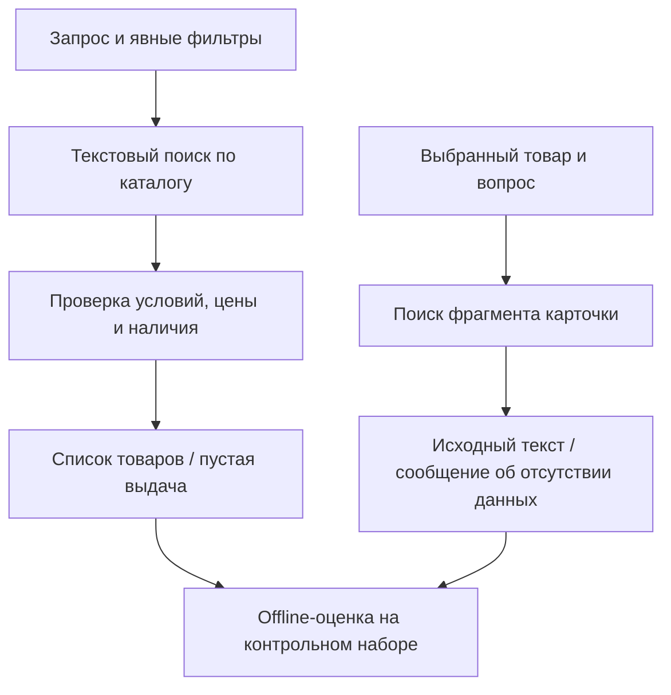
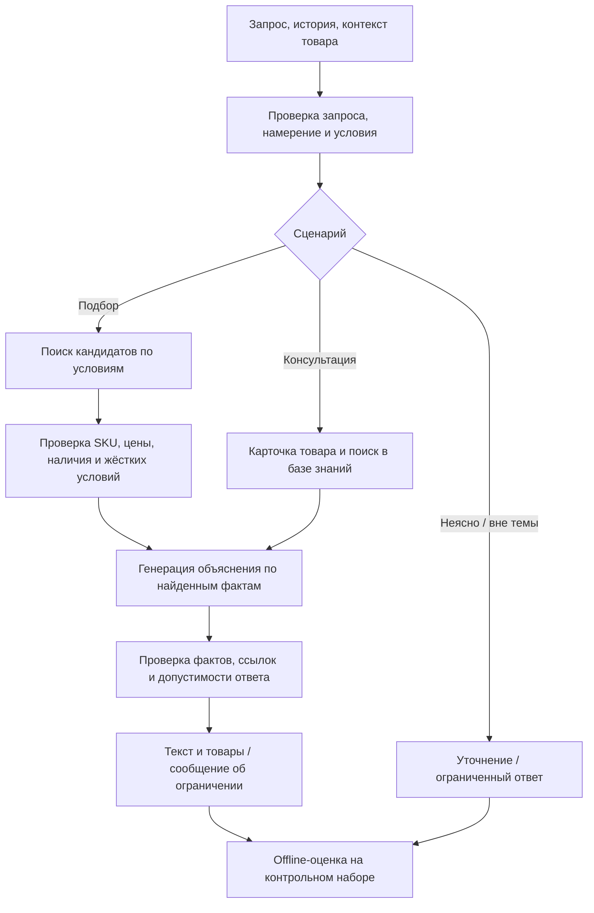

# ML System Design: диалоговый бьюти-ассистент

Автор: Юлия Горшкова · Итерация: HW1 · Статус: проект дизайна · 29.10.2026

## 1. Цели и предпосылки

### 1.1. Зачем идём в разработку продукта

Покупателю сложно перевести потребность в фильтры каталога и понять, подходит ли
конкретное средство. Ассистент помогает сузить выбор и объясняет рекомендации.
Бизнес-гипотеза: помощь увеличит долю пользователей, добавивших товар в корзину,
без роста возвратов и неприемлемых расходов на диалог.

ML нужен для понимания свободного запроса и продолжений диалога. Собственная
оркестрация позволит управлять источниками и качеством объяснений. Пользу
относительно обычного поиска предстоит проверить.

### 1.2. Бизнес-требования и ограничения

- Подбирать реальные товары с учётом явно заданных бюджета, свойств и контекста.
- Отвечать по характеристикам и применению товара на основе проверяемых источников.
- Сохранять условия текущего диалога; уточнять недостающие данные без повторных вопросов.
- Проверять цену и наличие перед выдачей; не придумывать товары и свойства.
- При нехватке данных сообщать об ограничении; при сбое предлагать повтор или поиск.
- Не ставить диагнозы и не назначать лечение. Пограничные случаи требуют экспертных правил.

Предлагаемая оценка пилота:

| Показатель                       | Как измерять                                                                     |
| -------------------------------- | -------------------------------------------------------------------------------- |
| Основной: add-to-cart conversion | Пользователи с добавлением в корзину / все пользователи экспериментальной группы |
| Польза ответа                    | Доля успешно решённых задач по экспертной разметке                               |
| Защитные показатели              | Возвраты, жалобы и критические ошибки рекомендаций                               |
| Экономика и скорость             | Стоимость диалога, p95 полного ответа, доля технических ошибок                   |

Порог улучшения, окно атрибуции, бюджет и ограничения по времени ответа ещё не заданы.
Критические нарушения достоверности и жёстких фильтров в контрольном наборе
блокируют пилот; численные цели остальных показателей согласуются до эксперимента.

### 1.3. Что входит в scope

HW1: документ и воспроизводимые настройки репозитория. Состав MVP:

| Входит                                            | За пределами первой итерации                                |
| ------------------------------------------------- | ----------------------------------------------------------- |
| Подбор по запросу и изменение условий в диалоге   | Аналоги, сравнение нескольких товаров, сложные рутины       |
| Консультация по одному товару                     | Персонализация по покупкам и долговременная память          |
| Обработка неоднозначного и нерелевантного запроса | Полноценная поддержка, оформление заказа                    |
| Offline-сравнение baseline и MVP                  | Production-запуск, разработка фронтенда и чатовой платформы |

Интерфейс, хранение истории и действия с корзиной относятся к внешнему приложению.
AI-сервис получает историю на входе и остаётся stateless. Категории предстоит
выбрать; масштабирование и автоматическое обновление индексов отложены.

### 1.4. Предпосылки решения

| Данные                                   | Для чего нужны               | Что ещё проверить                   |
| ---------------------------------------- | ---------------------------- | ----------------------------------- |
| Каталог: SKU, описание, состав, атрибуты | Поиск и факты о товаре       | Полнота полей и право использования |
| Цена и наличие по географии              | Проверка возможности покупки | Актуальность и контракт источника   |
| Экспертные материалы, тестовые диалоги   | Retrieval и оценка ответов   | Достоверность, покрытие и разметка  |

Предполагаются русскоязычный текст, LLM API и разрешённые открытые или синтетические
данные. Обучение собственной LLM и использование внутренних данных не планируются.

## 2. Методология

### 2.1. Постановка задачи

Вход: сообщения диалога, контекст страницы, выбранный товар и география,
если доступны. Выход: ответ, идентификаторы товаров и уточнение при необходимости.
Решаем задачи классификации намерения, извлечения условий, поиска кандидатов
и генерации ответа с опорой на источники (RAG).

**Baseline:** обычный поиск по тексту и явно заданным фильтрам; консультация
возвращает релевантный фрагмент карточки. Генерации и понимания истории нет.
**MVP:** LLM извлекает условия из диалога, выбирает сценарий и объясняет
результаты поиска или retrieval. Конкретные модели выбираются экспериментом.

### 2.2. Блок-схемы решения

#### 2.2.1. Baseline

#### 2.2.2. MVP

При пустой выдаче условия не ослабляются молча. Неподтверждённая цена или
наличие исключают рекомендацию к покупке. Ошибки поиска и генерации ведут
к сообщению об ограничении; число вызовов и повторы ограничены.

### 2.3. План проверки

1. Подготовить каталог и сценарии подбора, уточнения, консультации и ошибок;
   зафиксировать версии данных.
1. Разделить диалоги на настройку и закрытый контроль без дублей. Разметить намерение,
   ограничения, релевантные SKU и факты ответа.
1. Сравнить baseline и MVP на одинаковых данных: macro-F1 намерений, Recall@k поиска,
   успех задачи, фактическую обоснованность, нарушения фильтров, задержку и стоимость.
   Зафиксировать модели, промпты и конфигурацию. Измерений пока нет.
1. Проверять ответы экспертами; LLM-as-a-judge использовать после сверки с их оценками.
   После offline-проверки предложить A/B: обычный поиск против доступа к ассистенту,
   случайное назначение по пользователю до показа точки входа. Объём и длительность
   рассчитать по исходной конверсии и выбранному минимальному эффекту.

## 3. Открытые решения

- Какие категории, источники и объём данных доступны для экспериментов?
- Кто проверяет достоверность консультаций и размечает успешность ответа?
- Какие пороги качества, бюджет, нагрузка и p95 допустимы?
- Каковы атрибуция корзины и возвратов, размер пилота и условия остановки?
