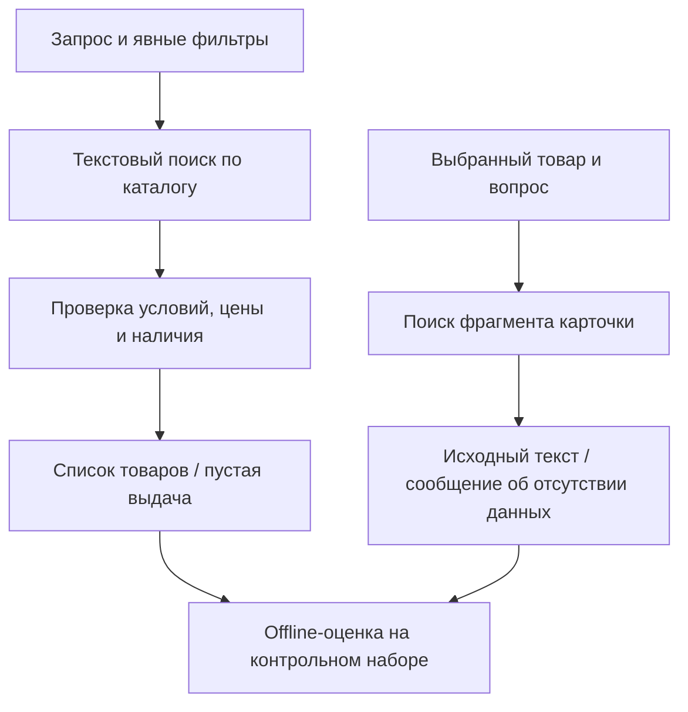
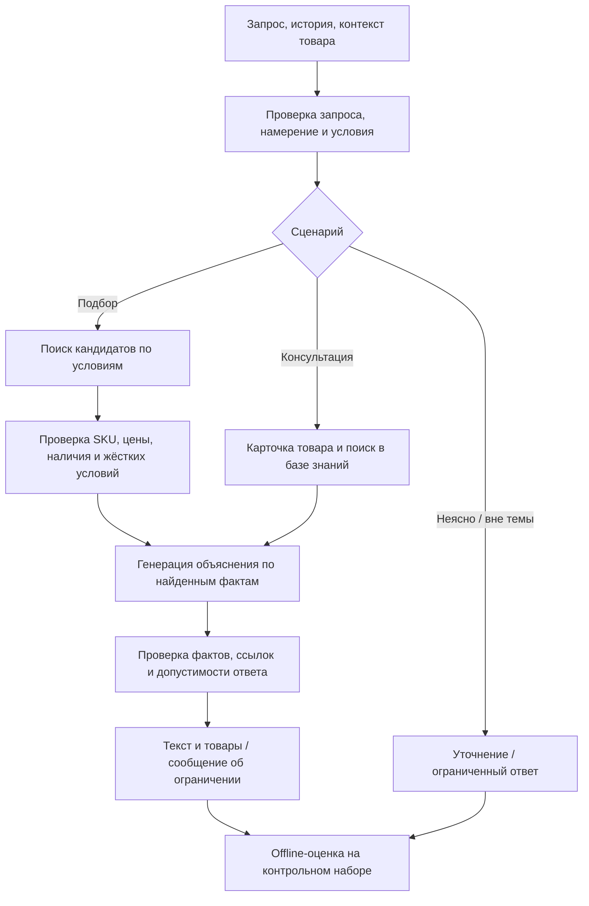

# ML System Design: диалоговый бьюти-ассистент

Автор: Юлия Горшкова · Итерация: HW1 · Статус: проект дизайна · 29.10.2026

## 1. Цели и предпосылки

### 1.1. Зачем идём в разработку продукта

Покупателю сложно перевести потребность в фильтры каталога и понять, подходит ли
конкретное средство. Ассистент помогает сузить выбор и объясняет рекомендации.
Основная бизнес-цель — увеличить конверсию в добавление в корзину на
1 процентный пункт относительно контроля: например, с 20% до 21%.
Первый этап пилота также оценивает вовлечённость, качество ответов и нагрузку.
Прирост конверсии должен достигаться без роста возвратов и неприемлемых расходов
на диалог.

ML нужен для понимания свободного запроса и продолжений диалога. Собственная
оркестрация позволит управлять источниками и качеством объяснений. Пользу
относительно обычного поиска предстоит проверить.

### 1.2. Бизнес-требования и ограничения

- Подбирать реальные товары с учётом явно заданных бюджета, свойств и контекста.
- Отвечать по характеристикам и применению товара на основе проверяемых источников.
- Сохранять условия текущего диалога; уточнять недостающие данные без повторных вопросов.
- Проверять цену и наличие перед выдачей; не придумывать товары и свойства.
- При нехватке данных сообщать об ограничении; при сбое предлагать повтор или поиск.
- Не ставить диагнозы и не назначать лечение. Пограничные случаи требуют экспертных правил.

Показатели MVP:

| Показатель                                 | Как измерять                                                                                                       |
| ------------------------------------------ | ------------------------------------------------------------------------------------------------------------------ |
| Основной: конверсия в добавление в корзину | Доля пользователей с добавлением в корзину в каждой группе за одинаковое окно наблюдения; цель — прирост на 1 п.п. |
| Вовлечённость                              | Пользователи группы B, начавшие диалог / все пользователи группы B                                                 |
| Качество ответа                            | Доля запросов с выполнением всех параметров матрицы рубрик и параметров                                            |
| Защитные показатели                        | Жалобы, возвраты и критические ошибки рекомендаций                                                                 |
| Производительность и ресурсы               | Время ответа, доля технических ошибок, загрузка GPU и стоимость диалога                                            |

SLA обработки пользовательского запроса — 10–12 секунд. Вычислительный бюджет —
8 × NVIDIA H100; отдельный денежный лимит на диалог не установлен.
Первый этап A/B-пилота — 10 000 пользователей суммарно, по 5 000 в группе.
Он проверяет вовлечённость, качество и фактическую нагрузку. Для проверки
целевого бизнес-эффекта планируется расширение выборки до 80 000 пользователей
суммарно, по 40 000 в группе, после успешного первого этапа.
Критические нарушения достоверности и жёстких фильтров блокируют запуск.

### 1.3. Что входит в scope

HW1: документ и воспроизводимые настройки репозитория.
Категории MVP: макияж, уход, парфюмерия. Состав MVP:

| Входит                                            | За пределами первой итерации                                               |
| ------------------------------------------------- | -------------------------------------------------------------------------- |
| Подбор по запросу и изменение условий в диалоге   | Аналоги, сравнение нескольких товаров, сложные рутины                      |
| Консультация по одному товару                     | Персонализация по покупкам и долговременная память                         |
| Обработка неоднозначного и нерелевантного запроса | Полноценная поддержка, оформление заказа                                   |
| Offline-оценка и поэтапный A/B-пилот              | Масштабирование на всю аудиторию, разработка фронтенда и чатовой платформы |

Интерфейс, хранение истории и действия с корзиной относятся к внешнему приложению.
AI-сервис получает историю на входе и остаётся stateless. Масштабирование
на всю аудиторию и автоматическое обновление индексов отложены.

### 1.4. Предпосылки решения

| Данные                                     | Для чего нужны                                     | Доступность |
| ------------------------------------------ | -------------------------------------------------- | ----------- |
| Каталог: SKU, описания, составы и атрибуты | Поиск и факты о товаре                             | Есть        |
| Цены и наличие по географии                | Проверка возможности покупки                       | Есть        |
| Отзывы                                     | Дополнительная информация о пользовательском опыте | Есть        |
| База знаний                                | Retrieval для консультаций                         | Есть        |
| 250 тестовых диалогов                      | Offline-оценка baseline и MVP                      | Есть        |

Запросы русскоязычные. Готовая LLM вызывается через API; обучение собственной LLM
в первую итерацию не входит. Перед экспериментами проверяются актуальность,
полнота товарных данных и качество материалов базы знаний.

## 2. Методология

### 2.1. Постановка задачи

Вход: сообщения диалога, контекст страницы, выбранный товар и география,
если доступны. Выход: ответ, идентификаторы товаров и уточнение при необходимости.
Решаем задачи классификации намерения, извлечения условий, поиска кандидатов
и генерации ответа с опорой на источники (RAG).

**Baseline:** обычный поиск по тексту и явно заданным фильтрам; консультация
возвращает релевантный фрагмент карточки. Генерации и понимания истории нет.
**MVP:** LLM извлекает условия из диалога, выбирает сценарий и объясняет
результаты поиска или retrieval. Конкретные модели выбираются экспериментом.

### 2.2. Блок-схемы решения

#### 2.2.1. Baseline

#### 2.2.2. MVP

При пустой выдаче условия не ослабляются молча. Неподтверждённая цена или
наличие исключают рекомендацию к покупке. Ошибки поиска и генерации ведут
к сообщению об ограничении; число вызовов и повторы ограничены.

### 2.3. План проверки

1. Разделить тестовые диалоги на набор настройки и закрытый контроль без дублей.
   Зафиксировать версии данных, моделей, промптов и конфигурации.
1. Эксперты клиентского центра и методологи оценивают ответы по матрице рубрик
   и параметров. Запрос считается решённым только при выполнении всех параметров;
   частичное выполнение не засчитывается.
1. Сравнить baseline и MVP на одинаковом наборе: доля решённых запросов, macro-F1
   намерений, Recall@k поиска, фактическая обоснованность, нарушения фильтров,
   время ответа и ресурсы. LLM-as-a-judge проверяется на согласованность с экспертами.
1. В A/B-пилоте группа A использует приложение без ассистента, B — с ассистентом.
   Случайное распределение по пользователям 50/50 выполняется до показа точки входа.
   Конверсия считается по всем пользователям каждой группы, вовлечённость — по B.
   На первом этапе проверяются также фактическая нагрузка и SLA в пределах 8 × H100.

Расчёт выборки: нормальное приближение для двустороннего теста двух долей,
уровень значимости 5%, мощность 80%, единица наблюдения — уникальный пользователь. При исходной конверсии 20%
для обнаружения прироста на 1 п.п. нужно около 52 000 пользователей суммарно;
10 000 позволяют обнаружить прирост примерно от 2,29 п.п. с той же мощностью.
План 80 000 выбран консервативно при неизвестной исходной конверсии: максимальная
расчётная потребность для эффекта 1 п.п. — около 78 500 пользователей.
Выборка накапливается по уникальным пользователям; повторные запросы не увеличивают
её размер. Оценка предполагает полное наблюдение метрики в одинаковом окне.
Решение по конверсии принимается на запланированном размере выборки.
При изменении реализации после первого этапа основная проверка проводится заново.
