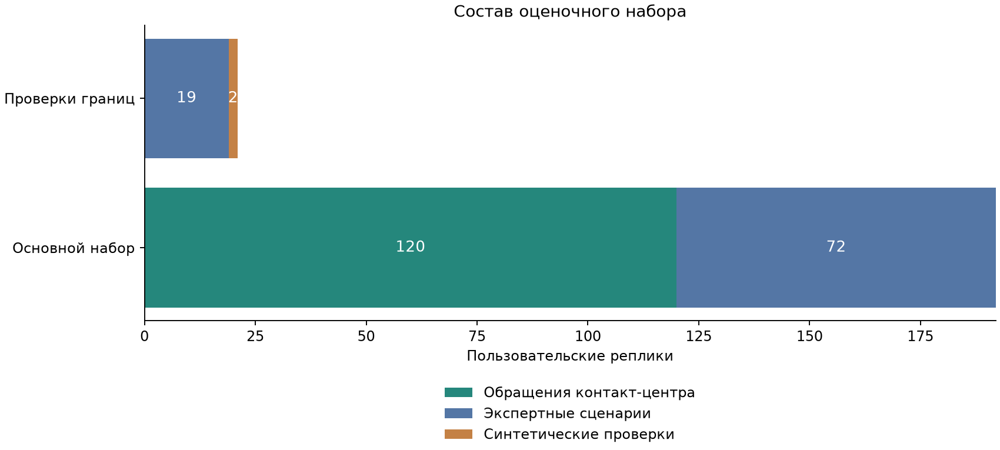
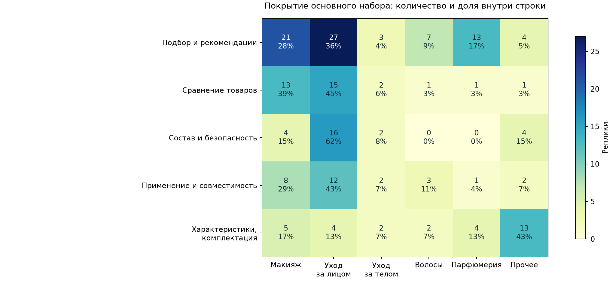
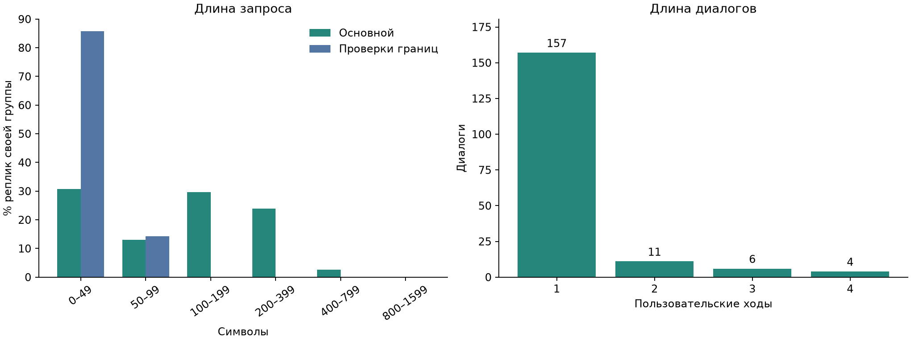

# EDA оценочного набора

Одна строка — пользовательская реплика; независимая группа — `dialog_id`.
Проанализирован финальный объединённый набор, а не промежуточный отбор из 250 обращений.
Числа и графики воспроизводятся из [агрегатов](summary.json) скриптом `scripts/eda.py`.

## Состав и покрытие

| Часть         | Реплики | Диалоги | Назначение                              |
| ------------- | ------: | ------: | --------------------------------------- |
| Основная      |     192 |     164 | Подбор и товарные консультации          |
| Hard negative |      21 |      14 | Границы возможностей и безопасный ответ |
| **Всего**     | **213** | **178** |                                         |

120 реплик получены из обращений контакт-центра, 91 — из экспертных сценариев,
2 — синтетические проверки. Из 101 реплики экспертных сценариев свёрнуты 10 повторных
одноходовых диалогов. Сохранено 56 разных последовательностей; одинаковое начало
разных продолжений не удалялось.

Пайплайн: 2382 исходных обращения → 1404 товарных вопроса → предразметка →
отбор 250 → сокращение до 120 → объединение с 91 экспертной репликой и 2 проверками.
Отбор целевой: пропорции итогового набора не описывают реальный клиентский поток.

В основной части больше всего подбора: 75/192 реплик (39,1%). Уход за лицом занимает
74/192 (38,5%), парфюмерия — 19/192 (9,9%). Есть 84 значения второго уровня каталога;
у одной реплики их может быть несколько. Нулевые ячейки показывают пробелы покрытия,
а не отсутствие соответствующих запросов у пользователей.

В основном наборе 93 персонализированные реплики и только 5 с недостатком информации.
Для проверки уточнений этого мало: нужно дополнить все три категории MVP кейсами
с пропущенным бюджетом, неоднозначным товаром и изменением условий.

## Объём контекста

157 диалогов одноходовые, 21 — многоходовой: 11 по два хода, 6 по три, 4 по четыре.
В основной части 45 реплик принадлежат многоходовым диалогам. Медиана длины запроса
основной части — 118 символов, p95 — 342,4; у негативов — 21 и 55 символов.
Символы не равны токенам: размер контекста измеряется токенизатором выбранной модели.
Разбивать по отдельным репликам нельзя: продолжение без истории теряет смысл.

## Качество и ограничения разметки

| Проверка                                                      | Результат                                                                                   | Следствие                                                                       |
| ------------------------------------------------------------- | ------------------------------------------------------------------------------------------- | ------------------------------------------------------------------------------- |
| Уникальность ID, пустые запросы, обязательные поля и критерии | Все 213 ID уникальны; пропусков нет                                                         | Структура пригодна для программной обработки                                    |
| Порядок ходов, длина диалога и единая роль                    | Нарушений нет                                                                               | Последовательности восстанавливаются по ID и ходу                               |
| Нормализованные полные последовательности                     | Повторов нет                                                                                | Можно формировать группы диалогов                                               |
| Повторяющиеся тексты отдельных реплик                         | 13 сверх первого вхождения; пересечений main/negative нет                                   | Одинаковое начало не удаляем, связанные сценарии держим в одной части валидации |
| Ответ оператора                                               | 120 заполненных полей, из них 6 пометок «нет ответа»; пригодных текстов 114, отсутствует 93 | Заполненная ячейка не всегда является эталоном                                  |
| Тип разметки                                                  | Есть категории, признаки и назначенные критерии                                             | Это не готовые pass/fail для новой версии ассистента                            |

Часть признаков получена LLM-предразметкой, назначения критериев — правилами.
Эксперты должны проверить их применимость перед приёмкой. Ответ оператора — кандидат
в эталон: его факты, актуальность и полноту также нужно проверять по каталогу и базе знаний.
Исторический `outcome` повторён на ходах одного сценария; он не измеряет качество
новых ответов и не должен усредняться как независимая оценка каждой реплики.

Основная часть содержит 33 реплики сравнения товаров; есть критерии сложных рутин.
Они выходят за scope текущего MVP. Диагностический фильтр, исключающий целиком диалоги
со сравнением или критериями построения рутин, оставляет 147 реплик / 127 диалогов.
Это верхняя оценка доступного пула, а не готовый контроль: применимость прочих кейсов
тоже проверяется экспертами. Исходные роли не переписываются ради улучшения метрики.

## Конфиденциальность и применение

В запросах нет совпадений с шаблонами телефона и email; в ответах операторов есть
4 совпадения с шаблоном телефона. URL встречаются в 34 запросах и 51 ответе.
Регулярные выражения дают кандидатов для проверки и не доказывают отсутствие персональных
данных. Тексты, контакты, параметры ссылок и идентификаторы проверяются перед передачей
в контур оценки. В агрегатах нет реплик, ответов, исходных ID и персональных имён.

Набор подходит для диагностики и регрессии известных сценариев. Он не является случайной
выборкой трафика и уже использовался при подготовке решения. Для независимой приёмки
планируется новый закрытый контроль: 150 диалогов поддерживаемых сценариев и 40 проверок
границ. Малое число негативов и редкие критерии не позволяют утверждать, что редкие
ошибки устранены. Новые ответы оцениваются экспертами по применимым параметрам;
отсутствующий источник для проверки отмечается отдельно, а не превращается в успех.
